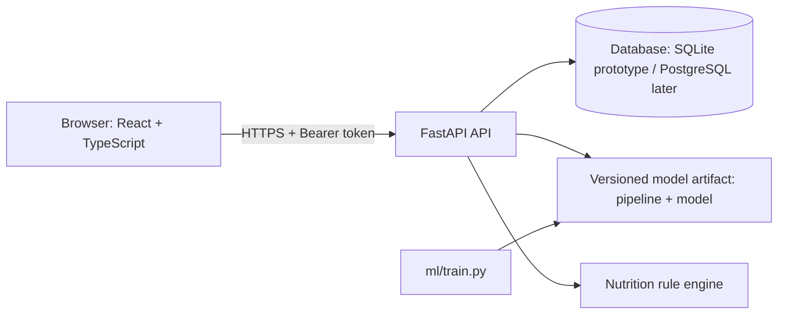
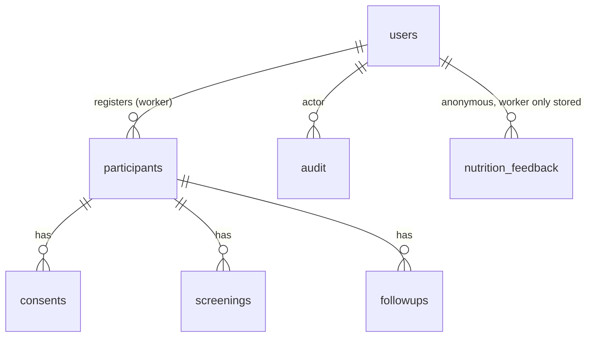

# Arogya AI: architecture and database

Roles: admin (accounts, audit, system), worker (own participants), researcher (aggregates, model results). Server-side checks on every endpoint.

## Health platform modules
Backend modules (`account`, `health_records`, `symptoms`, `wellness`, `care`, `admin_portal`) each expose `register(app, main)`. Sessions are stored server-side (`user_sessions`); a token is valid only while its session is. Admin endpoints require an admin-kind session (30 min, 20 min idle). Admin metrics come from counts, `daily_activity` and an events table that holds no health data.
